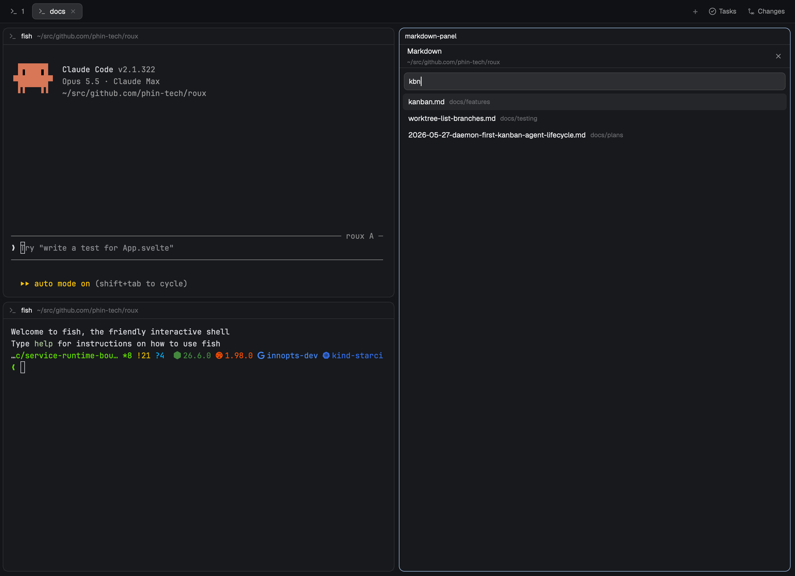
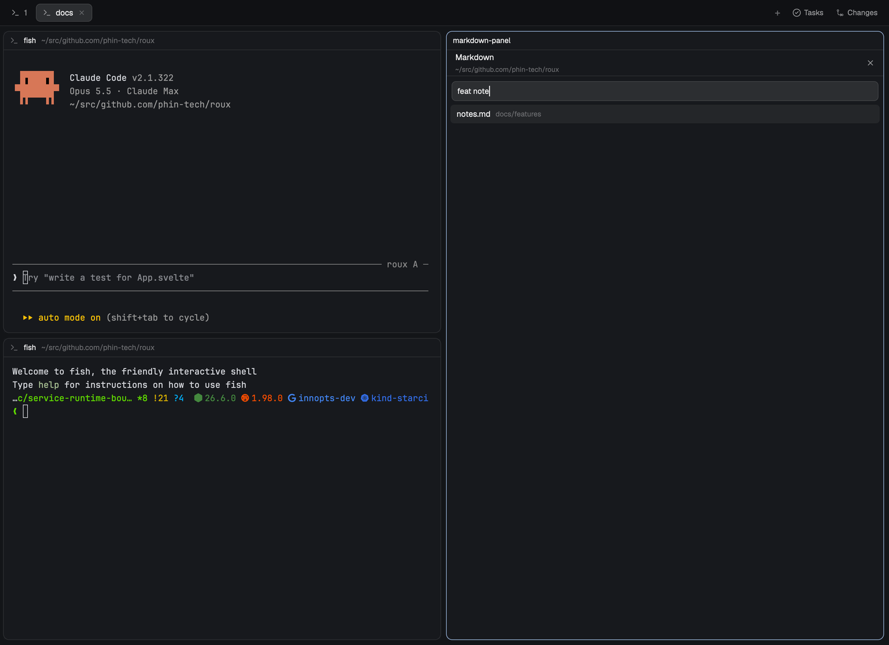
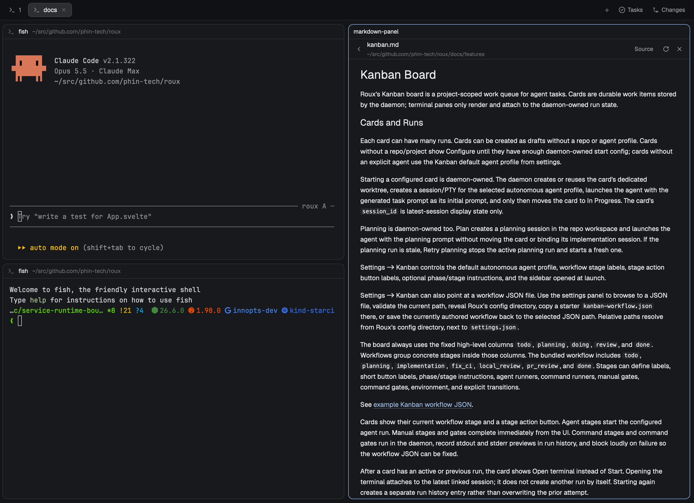

# herdr-markdown-panel

A markdown viewer and editor for the [Herdr app](https://herdr.dev), forked from the
`markdown-panel` mod in [jlopezlira/herdr-kanso](https://github.com/jlopezlira/herdr-kanso).

## Changes from upstream

- **Split pane.** Opens beside a terminal as well as in the floating window. Close and Escape close the pane when there is no window.
- **Fuzzy file search.** A search box above the file list matches file names and paths by their letters in order (`rdm` finds `README.md`). Enter opens the top match and Escape clears the box.
- **Copy button** above each fenced code block. It copies the code without the fences.
- **Run in terminal button** above each fenced code block. It sends the code to the first plain shell pane of the same tab and **presses Enter**. A pane running an agent is skipped.
- **Paste in terminal button** above each fenced code block. It pastes into the first terminal pane of the same tab and does **not** press Enter.

## Screenshots

The panel beside an agent and a shell, as `bin/md-tab` lays it out. Typing `kbn` finds `kanban.md` first:

Words narrow it further. `feat note` leaves only `docs/features/notes.md`:

Enter opens the top match:

## Install

Tell your agent: **`add the herdr mod at github.com/phin-tech/herdr-markdown-panel, and link bin/md-tab onto my PATH`**

Or by hand: copy `mods/markdown-panel` to `~/.config/herdr-app/mods/` and merge `keys.json` into `~/.config/herdr-app/keys.json`.

| Key | Does |
|---|---|
| `cmd-shift-m` | Floating window (press again to close) |
| `cmd-alt-m` | Split pane to the right of the focused pane |

To open a file from a script, pass it as a prop: `herdr-app do pane.split --direction right --mod markdown-panel --props '{"file":"/abs/path.md"}'`. The same works for `tab.new`.

`bin/md-tab` builds a whole tab (agent, panel, shell) from the shell: `md-tab --name review --file /abs/doc.md --agent claude --task "..."`. Link it onto your PATH.

To open a file from outside, write its absolute path to `~/.config/herdr-app/data/kanso-open/<name>.path`, then open the panel.

## What it runs

No network calls. It runs `sh`, `find`, `git ls-files`, `pwd` and `mkdir`, and `recent.sh` reads the clipboard, the focused terminal's screen (`hc read`) and `~/.claude/sessions`. It reads and writes any Markdown file you open. `markdown-handler.sh` (macOS file association) only runs if you run it.

## License

Apache-2.0. See `LICENSE` and `NOTICE` for the upstream authors.
